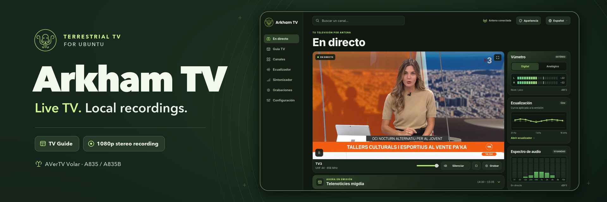
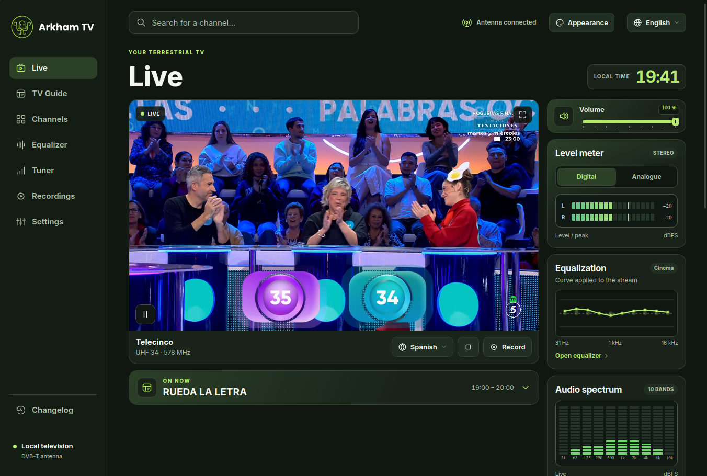
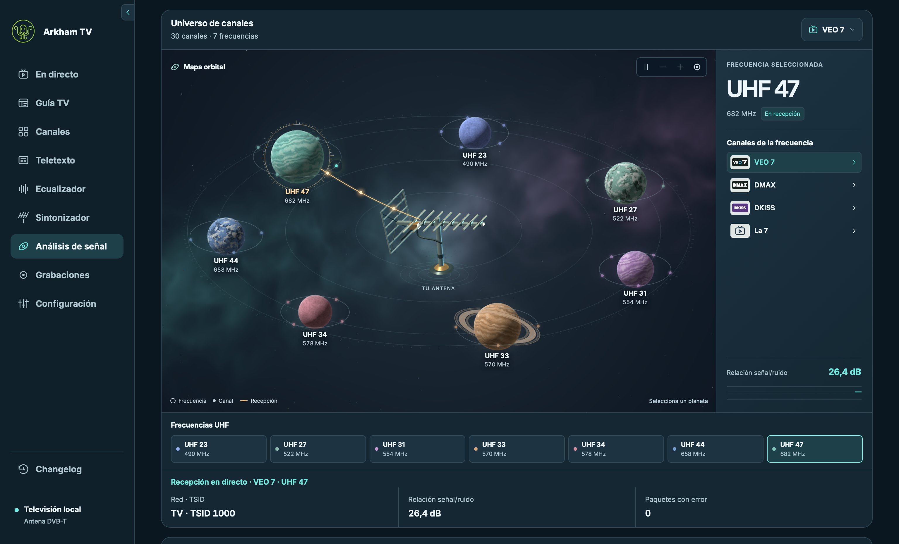
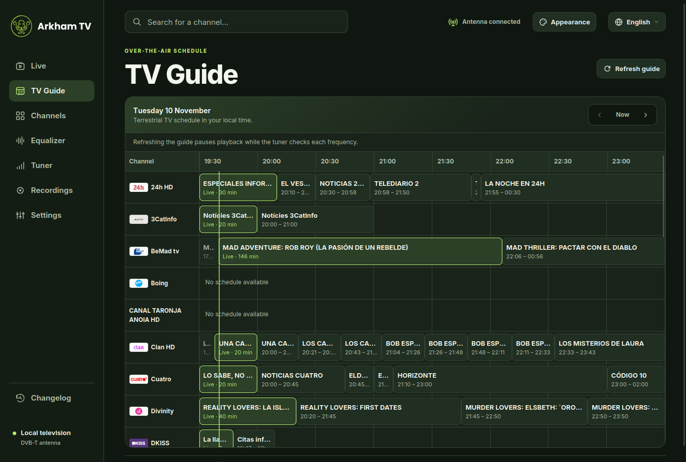
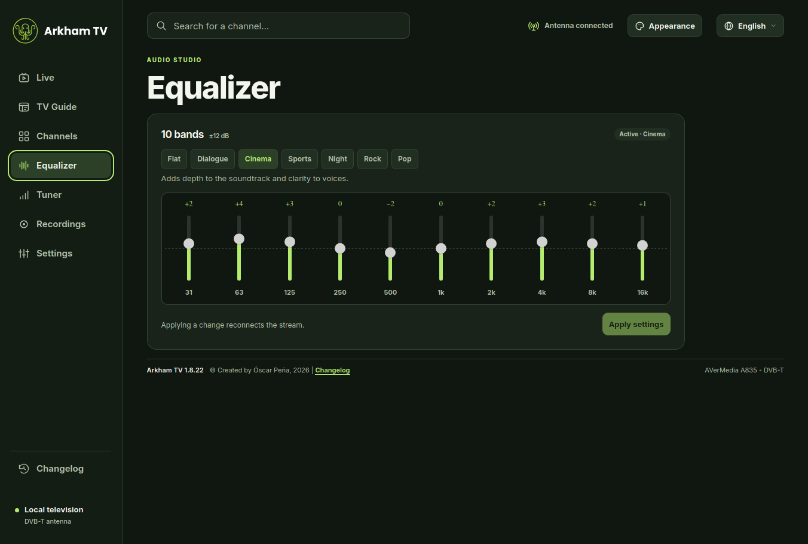
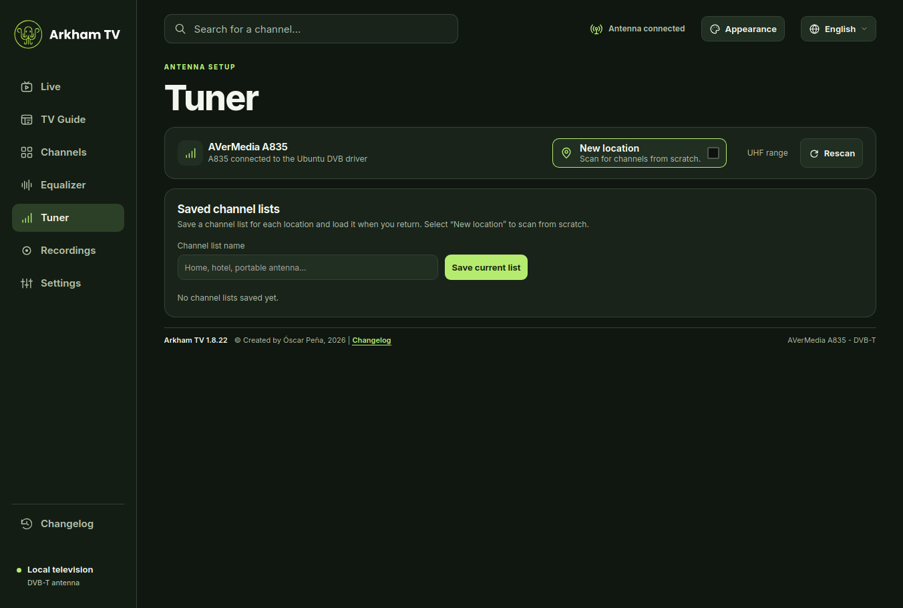
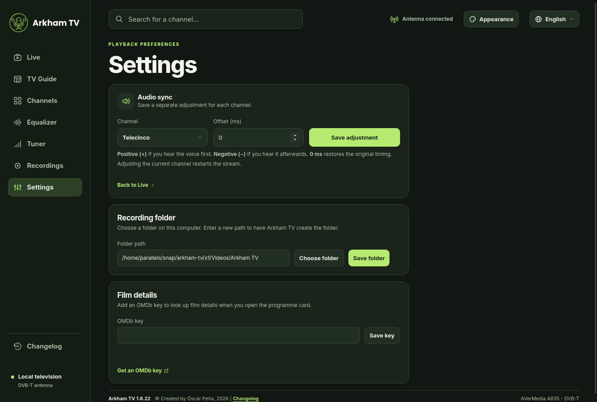

# Arkham TV



Arkham TV permite **ver y grabar la TDT en abierto** en macOS y Linux. Puedes conectar la antena a un sintonizador USB compatible o usar un receptor de televisión cuya salida HDMI vaya a una capturadora USB, como la **Elgato Cam Link 4K**. Incluye Guía TV, favoritos, perfiles de sintonización, ecualizador de diez bandas, controles de imagen y **transcripción e IA local**. La interfaz está disponible en español e inglés.

El proyecto empezó para recuperar el uso de los sintonizadores **AVerMedia A835 y A835B**. En Linux también funciona con otros sintonizadores DVB-T o DVB-T2 que el sistema reconozca como dispositivos DVB. Los perfiles guardan la lista de canales de cada lugar.

[Arkham TV en Snap Store](https://snapcraft.io/arkham-tv) · [Descargar Arkham TV 1.12](https://github.com/atreviainnov8spain/Arkham-TV/releases/tag/v1.12) · [Historial de cambios](docs/CHANGELOG.md) · [Licencia](LICENSE.md)

## Novedades de la 1.12

- **Universo de canales en Three.js:** nuevo atlas orbital en Análisis de señal, con planetas por frecuencia, inspector de canales y pulso de la recepción activa.
- **Transcripciones legibles:** párrafos continuos o guion con los tiempos en una columna de color. Exportación en texto o Markdown con tiempos opcionales.
- **Modelos de voz a elegir:** Whisper en distintos tamaños y los modelos experimentales **Parakeet TDT v3 INT8** y **Qwen3-ASR 0.6B INT8**, descargables en macOS y Linux. Qwen3 y Bonsai 2 siguen disponibles para el chat, los resúmenes y los informes.
- **Grabaciones con voces:** separación local opcional en **Voz 1**, **Voz 2**, etc., con nombres que puedes editar. Se aplica a grabaciones, manteniendo el directo sin ese procesamiento.
- **Biblioteca más clara:** distintivos **DIRECTO** y **GRABACIÓN**, título, fecha y modelo utilizado. Puedes limpiar el panel tras finalizar conservando la sesión y el audio pendiente.
- **Reproducción prioritaria:** cola local de audio pendiente, mejoras de protección en Linux y motores AVX2 para procesadores Intel/AMD compatibles. macOS conserva Whisper con Metal.

Las descargas incluyen **macOS Universal**, **Ubuntu ARM64** y **Ubuntu Intel/AMD**, además de los Snaps y ejecutables portátiles de Linux. [Ejecutables y comprobaciones SHA-256](https://github.com/atreviainnov8spain/Arkham-TV/releases/tag/v1.12)

## Novedades de la 1.10

- **Entrada HDMI** en macOS y Linux. Usa el mando del receptor para sintonizar y cambiar de canal. Arkham TV recibe el vídeo y el audio de la capturadora, permite grabar hasta 1080p con sonido estéreo y puede compartir la emisión en el móvil.
- **Imagen** en En directo. **Estándar** reproduce la imagen capturada sin filtros. También puedes elegir Película, Cine Filmmaker o Vívido. Con **Personal** puedes ajustar brillo, contraste, nitidez y color mientras ves la emisión. **Guardar mi ajuste** guarda un único perfil personal y reemplaza el anterior.
- **HDMI en Linux** con desentrelazado y cadencia ajustada a la capturadora. Con una entrada entrelazada de 25 fotogramas por segundo, el desentrelazado puede generar 50 fotogramas progresivos por segundo.

Las versiones anteriores incorporaron **Análisis de señal**, **Teletexto** y **Ver en el móvil**. El análisis de recepción, la Guía TV y el Teletexto recibidos por antena usan un sintonizador DVB. Para compartir la emisión, escanea el QR desde un iPhone o Android conectado a la misma red Wi-Fi.

## Capturas





| Guía TV | Ecualizador |
| --- | --- |
|  |  |

| Sintonizador | Configuración |
| --- | --- |
|  |  |

## Instalación

### Linux con Snap

Instala **Arkham TV** desde Snap Store o ejecuta `sudo snap install arkham-tv`. El canal estable distribuye la **1.12** para **ARM64** y **AMD64** (Intel y AMD de 64 bits). Si ya la tienes instalada, puedes buscar la actualización con `sudo snap refresh arkham-tv`. [Snap Store](https://snapcraft.io/arkham-tv)

Para usar un sintonizador de antena directa en una instalación nueva, habilita su acceso con `sudo snap connect arkham-tv:dvb`. [Permisos y compilación del Snap](snap/README.md)

### Ubuntu Desktop con paquete .deb

Descarga el paquete **1.12** de tu arquitectura. [Ubuntu AMD64 (Intel y AMD de 64 bits)](https://github.com/atreviainnov8spain/Arkham-TV/releases/download/v1.12/Arkham-TV-1.12-Ubuntu-Intel-x86_64.deb) · [Ubuntu ARM64](https://github.com/atreviainnov8spain/Arkham-TV/releases/download/v1.12/Arkham-TV-1.12-Ubuntu-ARM64.deb)

Abre el paquete de tu arquitectura en el **Centro de aplicaciones** de Ubuntu. También puedes instalar el archivo con `sudo apt install ./nombre-del-paquete.deb` desde la carpeta de descargas. A continuación, abre **Arkham TV** desde el menú de aplicaciones. El paquete incluye el lector DVB, FFmpeg y FFprobe. Ubuntu instala las dependencias del escritorio.

La edición `.deb` usa los permisos que tiene el usuario de la sesión gráfica. Puedes comprobar el sintonizador con `arkham-tv --diagnostico`.

### Flatpak de prueba para ARM64

El [paquete local de prueba](https://github.com/atreviainnov8spain/Arkham-TV/releases/tag/v1.8.22-flatpak.1) usa el entorno de ejecución de GNOME 49 y mantiene la versión 1.8.22. Instálalo desde la carpeta de descargas en un sistema ARM64 con Flatpak.

```sh
flatpak install --user --bundle ./Arkham-TV-1.8.22-ARM64-test.flatpak
flatpak run io.github.atreviainnov8spain.ArkhamTVTest
```

El paquete de prueba incluye acceso a dispositivos para que Arkham TV use `/dev/dvb`. Sigue necesitando que Linux detecte el sintonizador y que la sesión de escritorio tenga acceso al adaptador. [Preparación de la publicación en Flathub](docs/flathub-preparacion.md)

### macOS

Descarga el ZIP universal de **Arkham TV 1.12**, descomprímelo y abre **Arkham TV.app**. Requiere macOS 12.3 o posterior y funciona en Intel y Apple Silicon. La app incluye Python, los códecs y el lector USB. [macOS Universal](https://github.com/atreviainnov8spain/Arkham-TV/releases/download/v1.12/Arkham-TV-1.12-macOS-Universal.zip)

## Transcripción e IA local

1. En **Configuración → Modelos de IA local**, elige y descarga un modelo de voz y pulsa **Usar modelo**. Para conversar con el texto, descarga también un modelo de Qwen3 o Bonsai 2.
2. En **En directo**, abre **Asistente IA** y pulsa **Iniciar transcripción**. Desplegar el asistente no inicia la transcripción automáticamente.
3. En **Grabaciones**, pulsa **Transcribir** junto a Eliminar. El resultado aparecerá en **Transcripciones IA** identificado con su grabación de origen.
4. Para distinguir hablantes en archivos grabados, descarga los modelos de **Voces de grabaciones** y activa su interruptor. También puedes usar **Separar voces** en una transcripción de grabación guardada.

El texto se muestra en párrafos. **Marcas de tiempo** cambia a un guion por filas con el tiempo en una columna separada. Puedes renombrar las etiquetas de voz pulsando sobre ellas; los nombres de personajes o personas los asigna el usuario.

El chat puede trabajar con el directo o con transcripciones guardadas y generar respuestas estructuradas, tablas y gráficos respaldados por fragmentos de la fuente. Puedes exportar a **Markdown** o **texto**, elegir si incluyes las respuestas de IA y conservar o retirar las marcas de tiempo.

La inferencia se realiza en el equipo. Las descargas de modelos requieren Internet; el audio, las transcripciones y las consultas se procesan localmente. El audio pendiente se conserva mientras la reproducción tiene prioridad.

## Ver un receptor por HDMI

1. Conecta la antena al receptor TDT, por ejemplo un Edision nano T265+. Une su salida HDMI a una capturadora USB, como la Elgato Cam Link 4K, y conecta la capturadora al equipo.
2. En Arkham TV, abre **En directo → Entrada HDMI**.
3. En macOS, concede **Cámara** y **Micrófono** cuando el sistema lo pida. En el Snap de Ubuntu, si falta algún permiso, pulsa **Guardar auxiliar HDMI**, instala el archivo `arkham-tv-hdmi.deb` en el **Centro de aplicaciones** y vuelve a Arkham TV. Pulsa **Comprobar instalación** y después **Permitir**. Ubuntu solicita la autorización de un administrador. El auxiliar se instala una sola vez.
4. Selecciona el vídeo y el audio de la capturadora, elige el desentrelazado y la ganancia que necesites y pulsa **Ver HDMI**.

Si usas Parallels, asigna la capturadora a Ubuntu en **Dispositivos → USB**. El receptor gestiona la sintonización por antena. Usa su mando para cambiar de canal.

## Sintonizador y grabaciones

| Plataforma | Compatibilidad de sintonizadores | Controlador |
| --- | --- | --- |
| Linux | Sintonizadores DVB-T o DVB-T2 que el sistema exponga en `/dev/dvb`. Entre ellos están los AVerMedia A835 (`07ca:a835`, `07ca:b835`) y A835B (`07ca:1835`, `07ca:2835`, `07ca:3835`, `07ca:4835`). | Controlador DVB del kernel correspondiente a cada modelo. Los A835 y A835B usan `dvb_usb_af9035`. |
| macOS | A835 (`07ca:a835`) | Controlador USB del proyecto sobre IOKit |

Conecta la antena al sintonizador. En el primer arranque, Arkham TV busca servicios DVB-T entre los canales UHF 21 y 48. En **Sintonizador** puedes ajustar el rango y guardar listas para distintas ubicaciones. La guía usa los horarios y las sinopsis que envía cada emisora. En Ubuntu, la recepción de DVB-T2 está disponible con un sintonizador y un controlador compatibles. Los A835 y A835B aquí descritos reciben DVB-T.

El sintonizador recibe una frecuencia UHF cada vez. **Grabar** permite elegir pista de audio y resolución de salida entre 480p, 720p, 1080p y 4K. El archivo se guarda como MP4 con vídeo H.264 y audio AAC estéreo. Si la resolución de salida supera a la de la emisión, se amplía la imagen. Mantén la aplicación abierta y el equipo despierto para las grabaciones programadas.

## Arquitectura

```text
Antena → Sintonizador DVB USB ──────────────┐
Antena → Receptor TDT → Capturadora HDMI USB ┤
                                           └─ FFmpeg → HLS local y grabaciones MP4
                                                         └─ WebKit → imagen y audio
```

| Componente | Función |
| --- | --- |
| [app.py](app.py) | Servidor HTTP local, sintonía, procesos de vídeo, API y ciclo de grabación. Escucha en `127.0.0.1`. |
| [native/](native) | Detección USB, lector DVB, captura HDMI, análisis de tablas MPEG-TS, guía, pistas de audio y grabaciones. |
| [linux/](linux) | Ventana GTK con WebKitGTK y GStreamer, lector C del dispositivo DVB y empaquetado para Ubuntu. |
| [macos/](macos) | Ventana en Swift y WebKit, integración con macOS y empaquetado universal. |
| [snap/](snap) | Empaquetado para Snapcraft y auxiliar gráfico de permisos HDMI. |
| [web/](web) | Interfaz HTML, CSS y JavaScript, reproductor HLS, sincronización de audio, temas y traducciones. |
| [assets/](assets) | Iconos, recursos gráficos, catálogo de canales, versión e historial bilingüe. |

En Ubuntu, el servidor local se abre al iniciar la ventana. El lector utiliza `frontend`, `demux` y `dvr` del adaptador DVB que coincide con el identificador USB. FFmpeg prepara la emisión HLS y las grabaciones. El vúmetro muestra los niveles de la emisión, mientras que WebKit y GStreamer gestionan la reproducción por la salida de audio del sistema.

La edición nativa de Ubuntu guarda sus ajustes en `${XDG_DATA_HOME:-~/.local/share}/arkham-tv` y el Snap en `~/snap/arkham-tv/common`. En macOS, la app usa `~/Library/Application Support/Arkham TV Desktop`. La aplicación usa por defecto la carpeta de vídeos del usuario para las grabaciones. La consulta opcional de fichas de cine envía a OMDb el título y, si se indica, el año.

## Compilar la edición de Ubuntu

Los scripts de [linux/](linux) construyen FFmpeg y FFprobe estáticos con Zig, FFmpeg 8.1.2 y x264. Instala también `make`, `pkg-config` y CMake. Para compilar en x86-64 con ensamblador optimizado, instala `nasm`. El empaquetador usa Python 3 y produce el ejecutable portátil y su `.deb`. Los motores de IA se construyen con whisper.cpp v1.8.3 y llama.cpp b11556.

En **Configuración → Modelos de IA local** puedes elegir el tamaño de Whisper para transcribir y usar Qwen3 o Bonsai 2 para conversar con la transcripción. La aplicación descarga los modelos que elijas y conserva los que ya tengas instalados. Los modelos se ejecutan en el equipo.

En Linux, el asistente conserva el audio pendiente del directo en una cola local y continúa procesándolo cuando recupera recursos. En **Grabaciones**, el botón **Transcribir** crea una transcripción identificada por el título y la fecha del archivo en **Transcripciones IA**. Los motores de IA usan CPU con prioridad baja; los procesadores Intel/AMD compatibles seleccionan automáticamente la variante AVX2, conservando la variante genérica para equipos anteriores.

La versión **1.12** presenta las transcripciones en párrafos, con marcas de tiempo opcionales en pantalla y al exportar. Distingue el origen **DIRECTO** o **GRABACIÓN** y permite limpiar el panel tras finalizar conservando la sesión. Linux y macOS añaden **Parakeet TDT v3 INT8** y **Qwen3-ASR 0.6B INT8** como modelos experimentales descargables. macOS conserva su motor Whisper con Metal.

El instalador original permite recuperar los archivos fuente de las dependencias y sus licencias con `arkham-tv --fuentes`. Descomprime los archivos de FFmpeg y x264 y ajusta las rutas del ejemplo. Repite la compilación de los códecs para `aarch64` si también quieres generar el paquete ARM64.

```sh
ZIG=/ruta/a/zig
FFMPEG_SRC=/ruta/a/ffmpeg-8.1.2
X264_SRC=/ruta/a/x264-stable
MEDIA=/ruta/a/compilacion/media
AI=/ruta/a/compilacion/ia
WHISPER_SRC=/ruta/a/whisper.cpp-1.8.3
LLAMA_SRC=/ruta/a/llama.cpp-b11556

sh linux/build-media.sh "$ZIG" "$FFMPEG_SRC" "$X264_SRC" "$MEDIA" x86_64
bash linux/build-local-ai.sh "$ZIG" "$WHISPER_SRC" "$LLAMA_SRC" "$FFMPEG_SRC" "$AI"
python3 native/fetch_speech_runtime.py "$AI" --platform linux
python3 linux/package.py "$ZIG" "$MEDIA" \
  /ruta/a/ffmpeg-8.1.2.tar.xz /ruta/a/x264.tar.gz \
  --ai-helpers "$AI" --arch x86_64 --output dist/1.12
```

Para macOS, [macos/build-ffmpeg.sh](macos/build-ffmpeg.sh) compila para ambas arquitecturas con las herramientas de Xcode. [macos/package.py](macos/package.py) documenta las rutas de entrada del framework oficial de Python 3.13, los binarios de FFmpeg y el firmware AF9035 verificado. El empaquetador genera un ZIP universal. Para construir el Snap y su auxiliar HDMI, sigue los pasos de [snap/README.md](snap/README.md).

## Diagnóstico en Ubuntu

```sh
lsusb
ls -l /dev/dvb/adapter*/frontend*
arkham-tv --diagnostico
```

Si usas Parallels, asigna el sintonizador USB a Ubuntu desde **Dispositivos → USB**. Si el USB aparece pero Ubuntu no crea el adaptador DVB, comprueba el controlador y el firmware que indique el diagnóstico. Si ves movimiento en el vúmetro pero no oyes el directo, revisa la salida seleccionada y el volumen de Arkham TV en **Configuración → Sonido** de Ubuntu.

## Créditos y licencia

Desarrollo de **Óscar Peña de San Antonio**. Beta tester y contribuciones de **Pedro Miñano**. El código se distribuye bajo GPL-2.0-or-later. Los componentes y recursos de terceros conservan sus avisos y licencias. [Licencia](LICENSE.md) · [Fuentes de los logotipos de canales](assets/canales/FUENTES.md)
