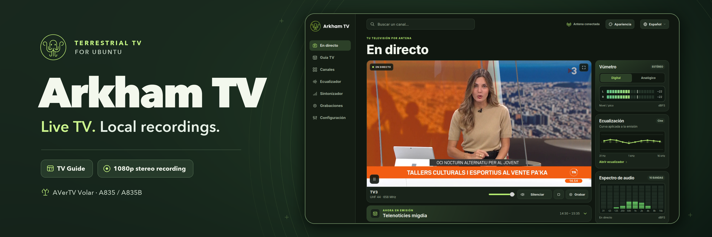
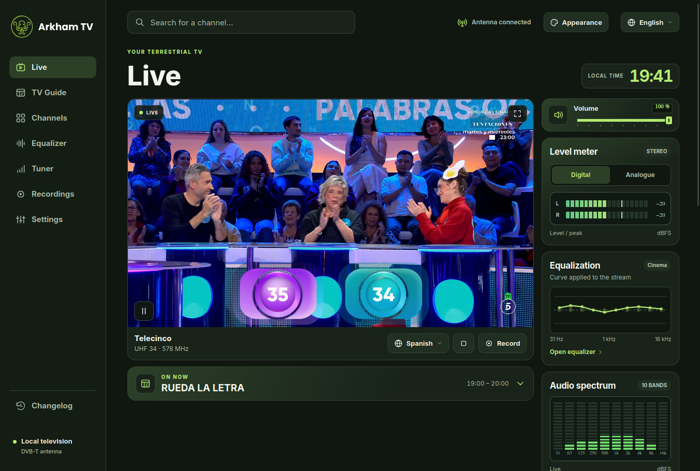
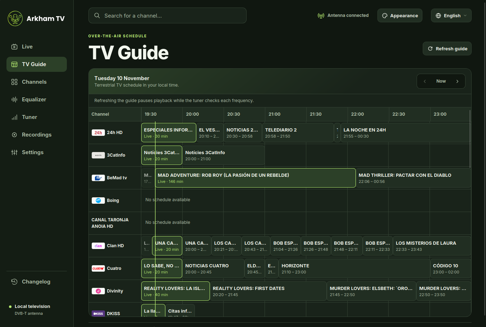
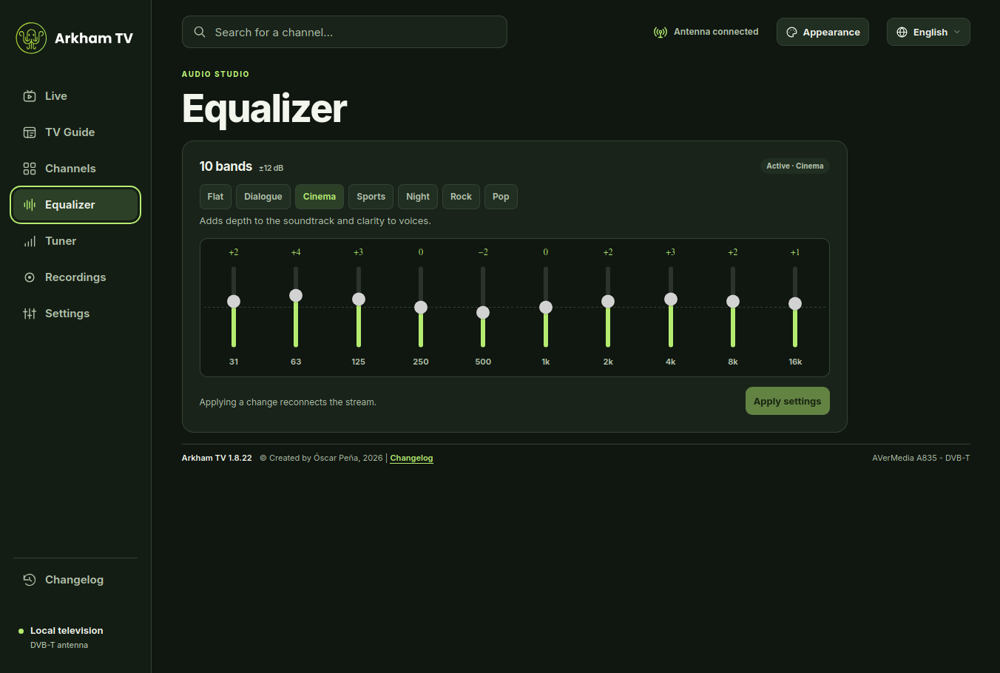
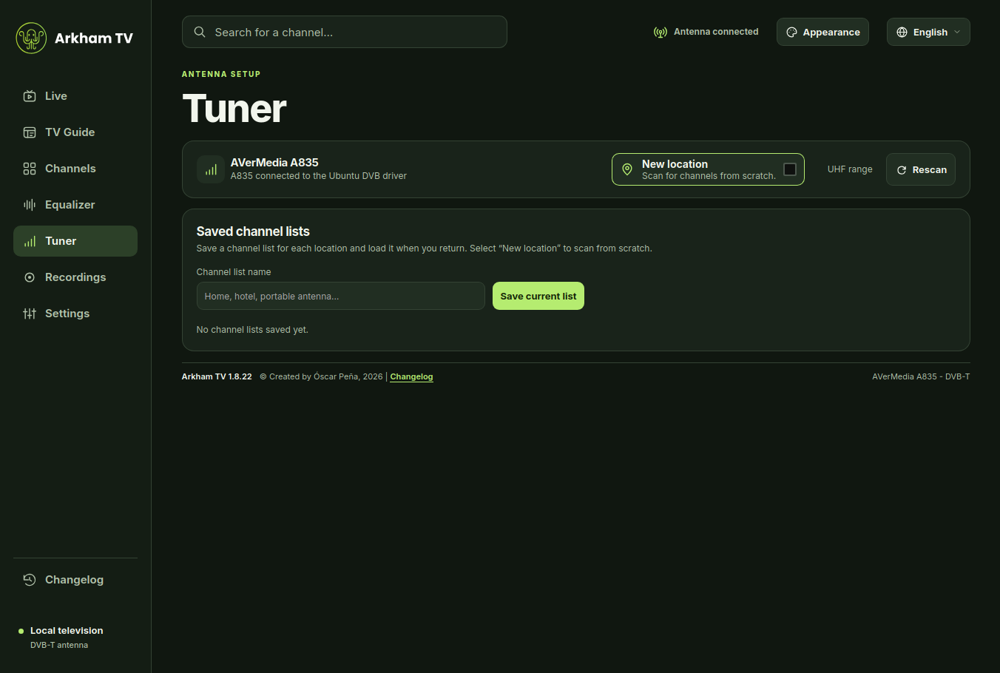
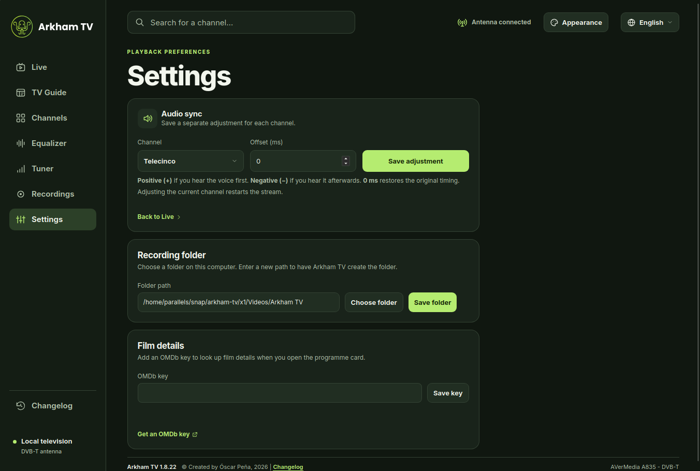

# Arkham TV



Arkham TV permite **ver y grabar la TDT en abierto** en macOS y Linux. Usa un sintonizador USB con antena o un receptor de televisión conectado por HDMI a una capturadora USB. Incluye Guía TV, favoritos, perfiles de sintonización y un ecualizador de diez bandas. La interfaz está disponible en español e inglés.

El proyecto está pensado para quienes tienen un **A835 o A835B** y han dejado de poder usarlo con su software habitual. Arkham TV permite seguir aprovechando el sintonizador con un portátil y una antena, también al viajar. Los perfiles guardan la lista de canales de cada lugar.

[Arkham TV en Snap Store](https://snapcraft.io/arkham-tv) · [Descargas de GitHub](https://github.com/atreviainnov8spain/Arkham-TV/releases) · [Historial de cambios](assets/changelog.json) · [Licencia](LICENSE.md)

## Novedades de la 1.10

- **Entrada HDMI** en macOS y Linux. Usa el mando del receptor para sintonizar y cambiar de canal. Arkham TV recibe el vídeo y el audio de la capturadora, permite grabar hasta 1080p con sonido estéreo y puede compartir la emisión en el móvil.
- **Imagen** en En directo. **Estándar** reproduce la imagen capturada sin filtros. También puedes elegir Película, Cine Filmmaker o Vívido. Con **Personal** puedes ajustar brillo, contraste, nitidez y color mientras ves la emisión. **Guardar mi ajuste** guarda un único perfil personal y reemplaza el anterior.
- **HDMI en Linux** con desentrelazado y cadencia ajustada a la capturadora. Con una entrada entrelazada de 25 fotogramas por segundo, el desentrelazado puede generar 50 fotogramas progresivos por segundo. El Snap estable publica esta actualización para ARM64 y AMD64.

Las versiones anteriores incorporaron **Análisis de señal**, **Teletexto** y **Ver en el móvil**. El análisis de recepción, la Guía TV y el Teletexto recibidos por antena usan un sintonizador DVB. Para compartir la emisión, escanea el QR desde un iPhone o Android conectado a la misma red Wi-Fi.

## Capturas



| Guía TV | Ecualizador |
| --- | --- |
|  |  |

| Sintonizador | Configuración |
| --- | --- |
|  |  |

## Instalación

### Linux con Snap

Instala **Arkham TV** desde Snap Store o ejecuta `sudo snap install arkham-tv`. El canal estable distribuye la **1.10** para **ARM64** y **AMD64** (Intel y AMD de 64 bits). [Snap Store](https://snapcraft.io/arkham-tv)

Para usar un sintonizador de antena directa en una instalación nueva, habilita su acceso con `sudo snap connect arkham-tv:dvb`. [Permisos y compilación del Snap](snap/README.md)

### Ubuntu Desktop con paquete .deb

El repositorio contiene el código de la **1.10**. La última descarga de GitHub incluye los paquetes **1.8.22** para AMD64 y ARM64. Los instaladores de la 1.10 se pueden generar con los pasos de compilación descritos abajo. [Descargas de la 1.8.22](https://github.com/atreviainnov8spain/Arkham-TV/releases/tag/v1.8.22)

Abre el paquete de tu arquitectura en el **Centro de aplicaciones** de Ubuntu. También puedes instalar el archivo con `sudo apt install ./nombre-del-paquete.deb` desde la carpeta de descargas. A continuación, abre **Arkham TV** desde el menú de aplicaciones. El paquete incluye el lector DVB, FFmpeg y FFprobe. Ubuntu instala las dependencias del escritorio.

La edición `.deb` usa los permisos que tiene el usuario de la sesión gráfica. Puedes comprobar el sintonizador con `arkham-tv --diagnostico`.

### Flatpak de prueba para ARM64

El [paquete local de prueba](https://github.com/atreviainnov8spain/Arkham-TV/releases/tag/v1.8.22-flatpak.1) usa el entorno de ejecución de GNOME 49 y mantiene la versión 1.8.22. Instálalo desde la carpeta de descargas en un sistema ARM64 con Flatpak.

```sh
flatpak install --user --bundle ./Arkham-TV-1.8.22-ARM64-test.flatpak
flatpak run io.github.atreviainnov8spain.ArkhamTVTest
```

El paquete de prueba incluye acceso a dispositivos para que Arkham TV use `/dev/dvb`. Sigue necesitando que Linux detecte el sintonizador y que la sesión de escritorio tenga acceso al adaptador. [Preparación de la publicación en Flathub](docs/flathub-preparacion.md)

### macOS

La aplicación requiere macOS 12.3 o posterior y funciona en Intel y Apple Silicon. El ZIP universal de GitHub corresponde a la 1.8.22. Para generar la 1.10, sigue las instrucciones de compilación de macOS. La app empaquetada incluye Python, los códecs y el lector USB. [Descargas de GitHub](https://github.com/atreviainnov8spain/Arkham-TV/releases)

## Ver un receptor por HDMI

1. Conecta la antena al receptor TDT, por ejemplo un Edision nano T265+. Une su salida HDMI a una capturadora USB, como la Elgato Cam Link 4K, y conecta la capturadora al equipo.
2. En Arkham TV, abre **En directo → Entrada HDMI**.
3. En macOS, concede **Cámara** y **Micrófono** cuando el sistema lo pida. En el Snap de Ubuntu, si falta algún permiso, pulsa **Guardar auxiliar HDMI**, instala el archivo `arkham-tv-hdmi.deb` en el **Centro de aplicaciones** y vuelve a Arkham TV. Pulsa **Comprobar instalación** y después **Permitir**. Ubuntu solicita la autorización de un administrador. El auxiliar se instala una sola vez.
4. Selecciona el vídeo y el audio de la capturadora, elige el desentrelazado y la ganancia que necesites y pulsa **Ver HDMI**.

Si usas Parallels, asigna la capturadora a Ubuntu en **Dispositivos → USB**. El receptor gestiona la sintonización por antena. Usa su mando para cambiar de canal.

## Sintonizador y grabaciones

| Plataforma | Modelos admitidos | Controlador |
| --- | --- | --- |
| Ubuntu | A835 (`07ca:a835`, `07ca:b835`) y A835B (`07ca:1835`, `07ca:2835`, `07ca:3835`, `07ca:4835`) | `dvb_usb_af9035` del kernel |
| macOS | A835 (`07ca:a835`) | Controlador USB del proyecto sobre IOKit |

Conecta la antena al sintonizador. En el primer arranque, Arkham TV busca servicios DVB-T entre los canales UHF 21 y 48. En **Sintonizador** puedes ajustar el rango y guardar listas para distintas ubicaciones. La guía usa los horarios y las sinopsis que envía cada emisora. En Ubuntu, la recepción de DVB-T2 está disponible con un sintonizador y un controlador compatibles. Los A835 y A835B aquí descritos reciben DVB-T.

El sintonizador recibe una frecuencia UHF cada vez. **Grabar** permite elegir pista de audio y resolución de salida entre 480p, 720p, 1080p y 4K. El archivo se guarda como MP4 con vídeo H.264 y audio AAC estéreo. Si la resolución de salida supera a la de la emisión, se amplía la imagen. Mantén la aplicación abierta y el equipo despierto para las grabaciones programadas.

## Arquitectura

```text
Antena → Sintonizador DVB USB ──────────────┐
Antena → Receptor TDT → Capturadora HDMI USB ┤
                                           └─ FFmpeg → HLS local y grabaciones MP4
                                                         └─ WebKit → imagen y audio
```

| Componente | Función |
| --- | --- |
| [app.py](app.py) | Servidor HTTP local, sintonía, procesos de vídeo, API y ciclo de grabación. Escucha en `127.0.0.1`. |
| [native/](native) | Detección USB, lector DVB, captura HDMI, análisis de tablas MPEG-TS, guía, pistas de audio y grabaciones. |
| [linux/](linux) | Ventana GTK con WebKitGTK y GStreamer, lector C del dispositivo DVB y empaquetado para Ubuntu. |
| [macos/](macos) | Ventana en Swift y WebKit, integración con macOS y empaquetado universal. |
| [snap/](snap) | Empaquetado para Snapcraft y auxiliar gráfico de permisos HDMI. |
| [web/](web) | Interfaz HTML, CSS y JavaScript, reproductor HLS, sincronización de audio, temas y traducciones. |
| [assets/](assets) | Iconos, recursos gráficos, catálogo de canales, versión e historial bilingüe. |

En Ubuntu, el servidor local se abre al iniciar la ventana. El lector utiliza `frontend`, `demux` y `dvr` del adaptador DVB que coincide con el identificador USB. FFmpeg prepara la emisión HLS y las grabaciones. El vúmetro muestra los niveles de la emisión, mientras que WebKit y GStreamer gestionan la reproducción por la salida de audio del sistema.

La edición nativa de Ubuntu guarda sus ajustes en `${XDG_DATA_HOME:-~/.local/share}/arkham-tv` y el Snap en `~/snap/arkham-tv/common`. En macOS, la app usa `~/Library/Application Support/Arkham TV Desktop`. La aplicación usa por defecto la carpeta de vídeos del usuario para las grabaciones. La consulta opcional de fichas de cine envía a OMDb el título y, si se indica, el año.

## Compilar la edición de Ubuntu

Los scripts de [linux/](linux) construyen FFmpeg y FFprobe estáticos con Zig, FFmpeg 8.1.2 y x264. Instala también `make` y `pkg-config`. Para compilar en x86-64 con ensamblador optimizado, instala `nasm`. El empaquetador usa Python 3 y produce el ejecutable portátil y su `.deb`.

El instalador original permite recuperar los archivos fuente de las dependencias y sus licencias con `arkham-tv --fuentes`. Descomprime los archivos de FFmpeg y x264 y ajusta las rutas del ejemplo. Repite la compilación de los códecs para `aarch64` si también quieres generar el paquete ARM64.

```sh
ZIG=/ruta/a/zig
FFMPEG_SRC=/ruta/a/ffmpeg-8.1.2
X264_SRC=/ruta/a/x264-stable
MEDIA=/ruta/a/compilacion/media

sh linux/build-media.sh "$ZIG" "$FFMPEG_SRC" "$X264_SRC" "$MEDIA" x86_64
python3 linux/package.py "$ZIG" "$MEDIA" \
  /ruta/a/ffmpeg-8.1.2.tar.xz /ruta/a/x264.tar.gz \
  --arch x86_64 --output dist
```

Para macOS, [macos/build-ffmpeg.sh](macos/build-ffmpeg.sh) compila para ambas arquitecturas con las herramientas de Xcode. [macos/package.py](macos/package.py) documenta las rutas de entrada del framework oficial de Python 3.13, los binarios de FFmpeg y el firmware AF9035 verificado. El empaquetador genera un ZIP universal. Para construir el Snap y su auxiliar HDMI, sigue los pasos de [snap/README.md](snap/README.md).

## Diagnóstico en Ubuntu

```sh
lsusb -d 07ca:
ls -l /dev/dvb/adapter*/frontend*
arkham-tv --diagnostico
```

Si usas Parallels, asigna el A835 a Ubuntu desde **Dispositivos → USB**. Si el USB aparece pero Ubuntu no crea el adaptador DVB, comprueba el controlador y el firmware que indique el diagnóstico. Si ves movimiento en el vúmetro pero no oyes el directo, revisa la salida seleccionada y el volumen de Arkham TV en **Configuración → Sonido** de Ubuntu.

## Créditos y licencia

Desarrollo de **Óscar Peña de San Antonio**. Beta tester y contribuciones de **Pedro Miñano**. El código se distribuye bajo GPL-2.0-or-later. Los componentes y recursos de terceros conservan sus avisos y licencias. [Licencia](LICENSE.md) · [Fuentes de los logotipos de canales](assets/canales/FUENTES.md)
